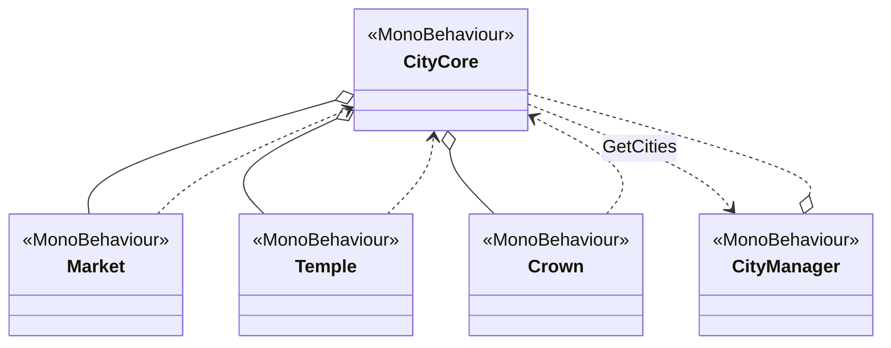
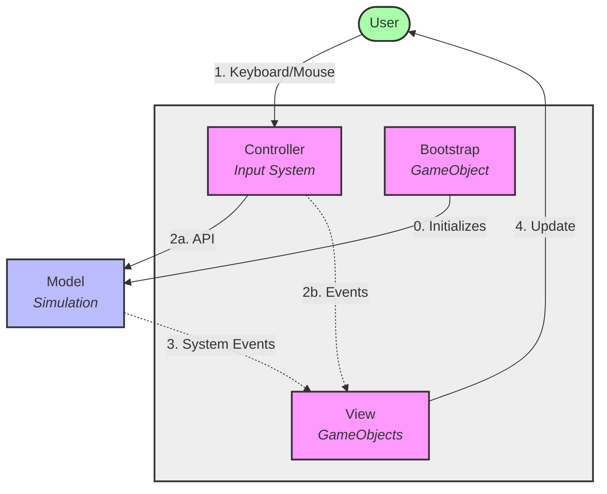

In this devlog, I am going to cover how (and why) I decoupled Kārum from the Unity engine.
The main benefit is that I can now run the simulation $64\times$ faster in headless mode.
In addition, this process enforces two pieces of good architecture advice that I've read hundreds of times:
<ol>
<li>Separate game logic from visuals.</li>
<li>Build a prototype, then start over when you create the real game.</li>
</ol>
If you're a solo dev in a genre with little or no simulation, such as horror or deckbuilders, this will be less applicable to you.
If your game is simulation-heavy with many interconnected systems, like Kārum, the upside can be huge.
If nothing else, hopefully a concrete example of these principles can help someone achieve similar results.

## The Unity Way

Before we get to the decoupling, it's useful to cover my usual Unity workflow.
This is by no means the best workflow; I just call it _The Unity Way_ when my software engineering friends roll their eyes at me -- usually just after I drag-and-drop a script.
Generally, I like to have every physical object (cities, caravans, characters, etc.) be a MonoBehaviour, while non-physical entities (like trade routes) get an infamous Manager class that holds their data.
It's easy to work with, I can edit an object's data directly on it, and I just need to drag and drop GameObjects to link scripts together.

An example with cities, estates, and a `CityManager` is outlined in Fig. 1. 
This eventually led to a master `CityCore` MonoBehaviour that holds references to a dozen components.
This cluttered the editor, and introduced additional coupling between objects by dragging-and-dropping cities into a central manager GameObject.

<figure class="panel" markdown="1">

  <figcaption>
      Messy class relations that show up when everything is a MonoBehaviour; Market, Temple, and Crown are all child classes of an Estate MonoBehaviour, which all other cities need to know about through a CityManager singleton MonoBehaviour.
  </figcaption>
</figure>

Each city will have one Market, Temple, and Crown, so a few `[RequireComponent]` tags and `GetComponent` calls in `Start` could easily ensure that all objects have the correct references.
The main problems I ran into were with cognitive loading (i.e., user errors): 
<ol>
<li>Editing the right public fields: every city has 3 estates, the City Core, and a TradeHub. Whose silver was I adjusting again?</li>
<li>Managing data ownership: should a trade route be owned by the CityManager? A separate (coupled) TradeManager, or shared between the connected cities?</li>
<li>Unnecessary coupling and API bloat: slightly different functions for trade hubs vs neighboring cities vs the data logger to query the price of a commodity. </li>
<li>Ad-hoc logging: Adding a new system usually means adding a new Manager class, which requires me to write another logger.</li>
</ol>

Each issue is self-inflicted, and can be avoided with discipline.
The refactor mitigates them, but the real benefit is _iteration speed_. 
In Unity, I can simulate $100$ years in about $5$ seconds; decoupling from the engine means I can run $64$ of these simulations in the same amount time, which is going to be key for design and balance as the simulation grows more complex.
This is the main issue I ran into <a href="https://karum.dev/2026/09/27/our-age-of-bronze.html">last month</a>, and running thousands of simulations is the only effective way for one person to balance a systems-heavy game.

## Model-View-Controller

One of the earliest architectural patterns for game dev that I learned is the <a href="https://en.wikipedia.org/wiki/Model%E2%80%93view%E2%80%93controller">model-view-controller</a>, where the model (simulation) is decoupled from the view (Unity scene) and control (input system).
You can see a high-level diagram in Fig. 2, where all Unity-specific code sits in the grey box.

<figure class="panel" markdown="1">

  <figcaption>
    Model-view architecture where pink squares are GameObjects in the scene, the blue is the decoupled simulation, and dashed arrows are events that fire.
  </figcaption>
</figure>

Note that the MVC in Fig. 2 relies on events to decouple the simulation from the GameObjects.
For example, when a caravan arrives at a city:
<ul>
<li>CityCore fires an OnCaravanArrives event.</li>
<li>The View subscribers CaravanUI, and TradeUI run:</li>
<ul>
<li>CaravanUI updates itself based on the new caravan state.</li>
<li>TradeUI popup informs the player.</li>
</ul>
</ul>
Further, because the controller and view know about the simulation, we can:
<ol>
<li>Call the PauseTime function via the sim API.</li>
<li>Wait for player input on a dialog box.</li>
<li>Call the relevant sim API function (e.g. CollectTariff).</li>
<li>Call the ResumeTime function via the sim API </li>
</ol>

Thus, we haven't actually lost any core game features; we have just separated the simulation from the visuals.
This may require some re-organization of the game logic, but once you're used to the architecture it's a one-time cost.
Further, we can enforce this model/view/control separation in Unity using `.asmdef` files.

## Assembly Definitions

I decided to start refactoring my game when I learned about <a href="https://docs.unity3d.com/6000.6/Documentation/Manual/cus-asmdef.html">assembly definitions</a> in Unity, which are essentially self-contained C# packages.
In Unity, you can create an `asmdef` through the right click$\to$create menu.
When you put it in a directory, that folder and any sub-folders are automatically grouped together into an assembly definition.
You can also explicitly define dependencies between `asmdef`s, including which assemblies have access to Unity Engine code.
In Kārum, I've set up the following `asmdef` files:
<ul>
<li><b>Sim</b>: No dependencies, cannot import any Unity code.</li>
<li><b>Authoring</b>: Contains all the game data, depends on Sim.</li>
<li><b>Interaction</b>: Controller and View components, depends on Sim, Authoring, and Unity.InputSystem.</li>
<li><b>UI</b>: View components just for the UI, depends on Interaction and all of its dependencies.</li>
<li><b>Editor</b>: Custom editor scripts, depends on Sim, Interaction, and Authoring.</li>
</ul>
This has two major benefits.
First, any view/control code has to go in the Interaction or UI folders; otherwise Unity will fail to compile.
This means that the architecture is imposed by the compiler rather than my own discipline.
Second, all of the important Sim libraries are self-contained.
This means I can compile Kārum outside of Unity and run thousands of simulations for tuning and balance.
I think this will be the *most significant* benefit, because the game systems are already too complex to hand-tune.

For very large games, this can also reduce compile time in Unity; e.g., since nothing depends on the UI `asmdef`, nothing outside of the UI code has to recompile when I make UI changes.

## Headless Simulations

If you're not familiar, running software in headless mode means running it without any graphics or user interface.
For Kārum, this means running the compiled `sim` package on the command line using a custom C# or Python script.
The output is a dump of simulation data in your favorite format.
In my case, that's CSV files that contain:
<ul>
<li>Every transaction in the game.</li>
<li>Every decision taken by the AI, such as building and staffing buildings.</li>
<li>State data saved every tick as a timeseries:</li>
<ul>
<li>Stock and price data for every commodity on every tick. </li>
<li>Commodity flow and demand across trade routes.</li>
<li>Total silver, population, and debt accrued for each city.</li>
<li>Caravan location and held cargo.</li>
</ul>
</ul>

As I mentioned at the top, I'm able to run $64$ simulations in headless mode in the same amount of time, which makes automated balancing possible.
For example, silver currently accumulates in one or two cities every run.
From the logs, I can compute the distribution of silver between cities or the flow of silver along trade routes.
I can then automatically adjust the game AI to maximize silver flow, or minimize static accumulation, through the network -- leading to a better game experience.
This effectively offloads AI fine-tuning to an optimization problem that can run on a laptop overnight.

I have also authored all of the game data in <a href="https://docs.unity3d.com/6000.6/Documentation/Manual/class-ScriptableObject.html">Scriptable Objects</a>, which can be easily converted to JSON format.
This means I can pull in the actual authoring components, optimize them in headless, and export them back into the engine.
Storing data in JSON also makes modding easier, but that's a topic for a future devlog.

## Worth it?

It's too soon to say whether the refactor saves me time, but I do think it will be key to balance the game effectively.
In my case the refactor took just over a week, and there are still some feature regressions for me to address.
I see immense value in pumping out a fast prototype, freezing the overall design, and implementing a model-view-control architecture from scratch for the real game.

If you waste as much time as me reading about gamedev online, you know that <a href="https://youtu.be/8Kr5TruT-YU">making</a> <a href="https://youtu.be/-K46mV38qD8">small</a> <a href="https://howtomarketagame.com/2025/11/04/the-optimistic-case-that-indie-games-are-in-a-golden-age-right-now/">games</a> is repeated everywhere, alongside <a href="https://howtomarketagame.com/2024/04/22/what-deep-rock-galactic-survivor-can-teach-us-about-early-access/">don't do early access</a>... _unless_ your game has systems-driven content that _needs_ players to identify balance issues.

My hope is that automated balancing will identify major problems, so player feedback is focused on tuning and tweaking the sim rather than game-breaking balance issues.

